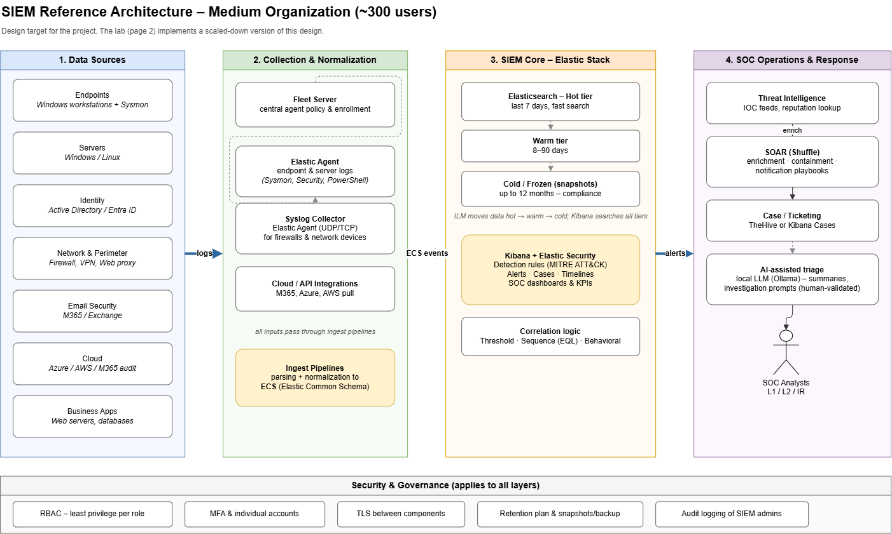
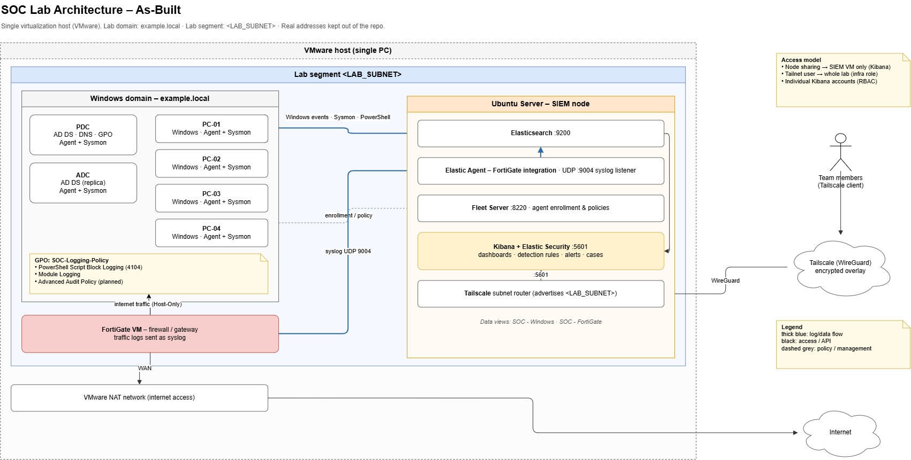

# SIEM Architecture

Two views of the same design:

| Diagram | Source | Purpose |
|---------|--------|---------|
| [Reference architecture](#a-reference-architecture-medium-organization) | `siem-architecture.drawio` | Design target: a medium organization (~300 users) |
| [Lab architecture (as-built)](#b-lab-architecture-as-built) | `siem-lab-architecture.drawio` | The scaled-down lab the team actually built |

Related: [ADR-001: Remote access via Tailscale](adr/ADR-001-remote-access-tailscale.md) · [Data Source Inventory](data-source-inventory.md) · [Log Onboarding Plan](log-onboarding-plan.md) · [Normalized Field Mapping](normalized-field-mapping.md) · [Retention Plan](retention-plan.md)

---

## A. Reference Architecture (Medium Organization)

The project's design target: a SIEM for an organization of about 300 users. The lab in section B implements a scaled-down version of it.



### Layer 1: Data Sources

| Source | Examples |
|--------|----------|
| Endpoints | Windows workstations + Sysmon |
| Servers | Windows / Linux |
| Identity | Active Directory / Entra ID |
| Network & perimeter | Firewall, VPN, web proxy |
| Email security | M365 / Exchange |
| Cloud | Azure / AWS / M365 audit |
| Business apps | Web servers, databases |

### Layer 2: Collection & Normalization

- **Fleet Server** for central agent policies and enrollment.
- **Elastic Agent** for endpoint and server logs (Sysmon, Security, PowerShell).
- **Syslog collector**: an Elastic Agent listening on UDP/TCP for firewalls and network devices.
- **Cloud / API integrations** that pull from M365, Azure and AWS.
- **Ingest pipelines** that parse every input and normalize it to **ECS** (Elastic Common Schema).

### Layer 3: SIEM Core (Elastic Stack)

**Elasticsearch storage tiers, managed by ILM:**

| Tier | Retention | Purpose |
|------|-----------|---------|
| Hot | Last 7 days | Fast search for active investigations |
| Warm | 8–90 days | Cheaper storage, still searchable |
| Cold / Frozen (snapshots) | Up to 12 months | Compliance and long-range hunting |

ILM moves data from hot to warm to cold automatically, and Kibana searches all tiers.

**Kibana + Elastic Security:** MITRE ATT&CK-mapped detection rules, alerts, cases, timelines, and SOC dashboards and KPIs.

**Correlation logic types:**
- **Threshold**: N events in a time window (e.g. repeated failed logons).
- **Sequence (EQL)**: ordered events across hosts or processes.
- **Behavioral**: deviation from normal activity.

### Layer 4: SOC Operations & Response

- **Threat intelligence**: IOC feeds and reputation lookups enrich alerts.
- **SOAR (Shuffle)**: enrichment, containment and notification playbooks.
- **Case / ticketing**: TheHive or Kibana Cases.
- **AI-assisted triage**: a local LLM (Ollama) writes alert summaries and investigation prompts. Its output is always validated by an analyst.
- **SOC analysts**: L1 / L2 / IR.

### Cross-cutting: Security & Governance

Applies to every layer:

- RBAC with least privilege per role
- MFA and individual accounts (no shared logins)
- TLS between components
- Retention plan with snapshots and backups
- Audit logging of SIEM administrators

### Data Flow

```text
Data sources --logs--> Collection & normalization --ECS events--> SIEM core --alerts--> SOC operations
```

---

## B. Lab Architecture (As-Built)

The scaled-down implementation running in the lab. Real addresses are kept out of the repo.



### Host and network

- A **single VMware host** (one physical PC) runs every VM.
- Lab segment: `<LAB_SUBNET>`.
- The VMware NAT network provides internet access behind the FortiGate.

### Windows domain: `example.local`

| Host | Role | Telemetry |
|------|------|-----------|
| `<PDC>` | AD DS, DNS, GPO | Elastic Agent + Sysmon |
| `<ADC>` | AD DS (replica) | Elastic Agent + Sysmon |
| `<PC-01>` … `<PC-04>` | Windows workstations | Elastic Agent + Sysmon |

**GPO `SOC-Logging-Policy`:**
- PowerShell Script Block Logging (event 4104)
- PowerShell Module Logging
- Advanced Audit Policy *(planned)*

### FortiGate VM

- Firewall and gateway between the lab segment and the VMware NAT network (WAN).
- Sends traffic logs to the SIEM node as **syslog over UDP 9004**.

### Ubuntu Server: SIEM node

| Component | Port | Role |
|-----------|------|------|
| Elasticsearch | `:9200` | Storage and search |
| Kibana + Elastic Security | `:5601` | Dashboards, detection rules, alerts, cases |
| Fleet Server | `:8220` | Agent enrollment and policies |
| Elastic Agent: FortiGate integration | UDP `:9004` | Syslog listener for FortiGate traffic logs |
| Tailscale subnet router | — | Advertises `<LAB_SUBNET>` to the tailnet |

Kibana data views: **SOC - Windows** and **SOC - FortiGate**. See [02-onboarding/data-views.md](../02-onboarding/data-views.md).

### Remote access (Tailscale)

Team members connect over Tailscale (WireGuard), with no open ports. See [docs/REMOTE-ACCESS.md](../docs/REMOTE-ACCESS.md) and [ADR-001](adr/ADR-001-remote-access-tailscale.md).

| Access model | Reaches | For |
|--------------|---------|-----|
| Node sharing | SIEM VM only (Kibana) | Default: least privilege |
| Tailnet user | Whole lab via the subnet router | Roles that need it (Infra) |

Every member also has an individual Kibana account with a role-based permission set (RBAC).

### Lab data flow

```text
Windows hosts (Agent + Sysmon) ──Windows events · Sysmon · PowerShell──> Elasticsearch
Windows hosts ──enrollment / policy──> Fleet Server
FortiGate VM ──syslog UDP 9004──> Elastic Agent (FortiGate integration) ──> Elasticsearch
Team members ──Tailscale (WireGuard)──> Kibana :5601 / subnet router
```

---

## C. Reference → Lab Mapping

| Reference layer | Lab implementation | Gaps / not implemented in the lab |
|-----------------|--------------------|-----------------------------------|
| **1. Data sources**: endpoints, servers | Windows workstations `<PC-01>`…`<PC-04>` with Sysmon | No Linux servers onboarded yet. No business apps (web servers, databases) |
| **1. Data sources**: identity | AD DS on `<PDC>` / `<ADC>` (`example.local`) | No Entra ID (cloud identity) |
| **1. Data sources**: network & perimeter | FortiGate VM traffic logs | No VPN or web proxy logs |
| **1. Data sources**: email, cloud | — | No email security or cloud sources (M365 / Azure / AWS) |
| **2. Collection**: Fleet, Agent, syslog | Fleet Server, Elastic Agent, FortiGate integration on UDP 9004 | — |
| **2. Collection**: cloud / API integrations | — | Not implemented (no cloud sources) |
| **2. Collection**: ECS normalization | Elastic integrations' built-in ingest pipelines | No custom pipelines yet |
| **3. SIEM core**: storage tiers | Single Elasticsearch node | No warm / cold / frozen tiers on one node in lab. Production retention defined in [retention-plan.md](retention-plan.md) |
| **3. SIEM core**: Kibana + Elastic Security | Kibana + Elastic Security, SOC dashboards v1 | Detection rules in progress (Phase 3) |
| **3. SIEM core**: correlation (threshold, EQL, behavioral) | — | Planned with the detection rules (Phase 3) |
| **4. SOC ops**: threat intelligence | — | Planned for Phase 3 |
| **4. SOC ops**: SOAR (Shuffle) | — | Planned for Phase 3 |
| **4. SOC ops**: case / ticketing | Kibana Cases available | TheHive not deployed |
| **4. SOC ops**: AI-assisted triage (Ollama) | — | Planned for Phase 3 |
| **Governance**: RBAC, individual accounts | Individual Kibana accounts with roles | — |
| **Governance**: TLS | WireGuard-encrypted remote access (Tailscale) | Kibana served over HTTP inside the tunnel (accepted lab limitation, see ADR-001) |
| **Governance**: retention, snapshots, audit | Retention policy documented in [retention-plan.md](retention-plan.md) | No snapshot repository. SIEM admin audit logging not configured in lab |

---

## D. How to Edit the Diagrams

1. Open the `.drawio` file at <https://app.diagrams.net> (**File > Open from > Device**) or in draw.io Desktop.
   - Reference: `siem-architecture.drawio`
   - Lab: `siem-lab-architecture.drawio`
2. Edit, then save the `.drawio` file in place.
3. Export the PNG: **File > Export as > PNG**, **Zoom 200%**, **light theme** (white background).
4. Save the PNG with the same name, `siem-reference-architecture.png` or `siem-lab-architecture.png`, so the links in this document keep working.
5. Commit the `.drawio` source and the PNG together.

> Placeholders only: use `<LAB_SUBNET>`, `example.local` and `<PC-01>` in diagrams. Never put real IPs, the real domain name, or real hostnames into the diagrams.
